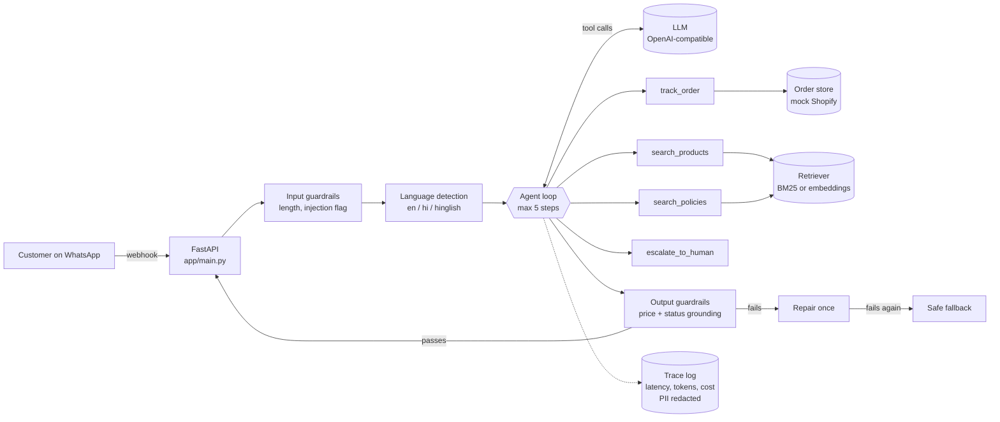

# D2C Support Agent

A WhatsApp-style customer support agent for an Indian D2C brand. It tracks orders, recommends products, answers policy questions in English, Hindi and Hinglish, and hands over to a human when it should. It is built to be measured: every change is checked against an eval suite, and every turn is traced for latency, tokens and cost.

The store, **Neem & Nest**, is fictional. Orders come from a mock Shopify store (`data/orders.json`) so the project runs with nothing but an LLM API key.

```
You:  mera order NN1004 kab aayega? phone ke last 4 digit 1111 hai
Neha: Aapka order NN1004 aaj out for delivery hai (Delhivery, DLV55129981).
      COD order hai, toh ₹999 ready rakhiye 🙂
```
*(Example of the intended behaviour. Run `python cli.py --debug` to see real output from your model.)*

## What it does

| Customer need | How the agent handles it |
|---|---|
| "Where is my order?" | `track_order` tool, verified with the last 4 digits of the phone number |
| "Which face wash for oily skin under ₹400?" | `search_products` over the catalogue, with price and category filters |
| "Can I return an opened shampoo?" | `search_policies` over store policies (retrieval) |
| Damaged item, angry customer, "talk to a human" | `escalate_to_human` creates a ticket |
| Hinglish or Hindi messages | Detects the language and replies in the same register |
| Medical questions | Declines to advise; suggests a patch test and a doctor |

## Architecture



A message goes through five stages (`agent/core.py`):

1. **Input guardrails**: empty messages get a greeting, long ones are truncated, prompt-injection attempts are flagged.
2. **Language detection**: script and Hindi function words decide English, Hindi or Hinglish, and the system prompt tells the model to reply in kind.
3. **Tool-calling loop**: the LLM calls tools until it can answer, capped at `MAX_STEPS` so a confused model cannot loop forever.
4. **Output guardrails**: every price in the reply must appear in a tool result from this turn, and any order status must come from a verified lookup. A failing reply gets one repair attempt, then a safe fallback.
5. **Trace**: latency per LLM and tool call, tokens, cost and flags go to `logs/traces.jsonl`, with phone numbers and emails redacted.

## Design decisions

| Decision | Alternative considered | Why |
|---|---|---|
| Phone verification inside `track_order` | Ask the model to check it | A prompt can be talked around; code cannot. The LLM never sees order details unless the digits match. |
| Price grounding check after generation | Trust the prompt rule "don't invent prices" | A wrong price is the costliest hallucination in commerce. The check is cheap and deterministic. |
| Repair once, then fallback | Fail silently or retry many times | One repair fixes most slips; a fixed fallback caps cost and latency on the rest. |
| BM25 by default, embeddings optional | Embeddings only | The catalogue is small and keyword-heavy (product names, "SPF 50"). BM25 needs no API calls, is fast and easy to debug. `RETRIEVER=embedding` switches to dense retrieval. |
| One chunk per product, one per policy section | Fixed-size chunks | Products and policy sections are self-contained. Splitting them would separate a price from its product. |
| Hinglish → English expansion before retrieval | Translate every message with the LLM | A small lexicon handles common words ("baal", "wapas", "kab") with no extra LLM call or latency. |
| Custom loop, OpenAI-compatible client | LangGraph / LangChain agents | The loop is ~80 lines and every step is visible and testable. Any provider with an OpenAI-compatible API works. |
| Tool errors returned as data | Raise exceptions | The model can recover ("please share the last 4 digits") instead of the conversation crashing. |
| Deterministic eval checks | LLM-as-judge first | Tool choice, required facts, language and leaks can be checked exactly, so results are cheap and trustworthy. A judge for tone can come later. |

## Evaluation

`evals/cases.yaml` holds 22 cases across orders, products, policies and safety, including Hindi and Hinglish, multi-turn, wrong-phone (no data leak), unknown order, out-of-stock, medical, prompt-injection and off-topic cases.

```bash
python -m evals.run_evals              # full suite
python -m evals.run_evals --repeat 3   # LLM outputs vary; repeat to measure stability
python -m evals.run_evals --case order_
```

Each case checks some of: which tools were called (or not), facts the reply must or must not contain, the reply language, and guardrail flags. The runner reports:

- overall and per-category pass rate
- tool-selection accuracy
- language match rate
- grounding repairs and fallbacks
- p50 / p95 latency
- tokens and cost per case

### Results

<!-- Run the suite and paste your numbers here. Keep the model name and date. -->

| Model | Date | Pass rate | Tool accuracy | Language match | p95 latency | Cost / 22 cases |
|---|---|---|---|---|---|---|
| _your model_ | _date_ | _x / 22_ | _%_ | _%_ | _ms_ | _$_ |

Failures worth noting, and what changed to fix them, go here too.

## Tests

37 unit tests run offline, with a scripted fake LLM, so no API key or network is needed:

```bash
python -m pytest            # or: python -m unittest discover tests
```

They cover language detection, retrieval ranking, tool validation, phone verification, guardrails, the repair and fallback paths, the step cap, multi-turn history, WhatsApp payload parsing and the eval runner itself.

## Run it

```bash
git clone https://github.com/Shriyam-22/d2c-support-agent.git
cd d2c-support-agent
python -m venv .venv && source .venv/bin/activate   # Windows: .venv\Scripts\activate
pip install -r requirements.txt
cp .env.example .env                                # add LLM_API_KEY (and token prices for cost tracking)

python cli.py --debug                               # chat in the terminal
uvicorn app.main:app --reload                       # HTTP API on :8000
```

```bash
curl -X POST localhost:8000/chat -H "Content-Type: application/json" \
  -d '{"session_id": "demo", "message": "shipping free hai kya?"}'
```

### Connecting the real systems

- **Shopify**: implement `get_order(order_id)` in a class that calls the Shopify Admin API and pass it to `build_agent(store=...)`. Nothing else changes.
- **WhatsApp**: point a Meta WhatsApp Cloud API webhook at `/webhook/whatsapp` and set the `WHATSAPP_*` variables. Without them the webhook returns the reply in its response, which is handy for local testing.

## Project structure

```
agent/
  core.py         agent loop, repair/fallback, wiring
  tools.py        tool schemas (Pydantic), validation, implementations
  retrieval.py    chunking, BM25, embedding retriever
  language.py     en / hi / hinglish detection, Hinglish -> English expansion
  guardrails.py   input checks, price & status grounding, PII redaction
  tracing.py      per-turn latency, tokens, cost, JSONL log
  llm.py          OpenAI-compatible client behind a small interface
  store.py        order store interface + mock Shopify
  prompts.py      system, repair and fallback prompts
app/
  main.py         FastAPI: /chat and WhatsApp webhook
  whatsapp.py     webhook parsing, sending replies
evals/            eval cases and runner
tests/            offline unit tests with a scripted LLM
data/             mock catalogue, orders and policies
```

## Limitations and next steps

- Sessions are in memory; production needs Redis or a database, and the WhatsApp webhook should queue work instead of answering inline.
- The Hinglish lexicon is small and hand-written. Next: log real queries, add the misses, and compare against an LLM rewrite step.
- BM25 sometimes ranks a related policy above the right one for mixed-language queries; the tool returns the top two sections to compensate. Embeddings or a reranker would help.
- Traces are JSONL files. Next: send them to Langfuse or LangSmith for dashboards.
- Add an LLM-as-judge score for tone and helpfulness, and run the evals in CI on every pull request.

## Tech stack

Python · OpenAI-compatible LLM APIs with tool calling · Pydantic · FastAPI · BM25 / embeddings with NumPy · WhatsApp Cloud API · pytest
